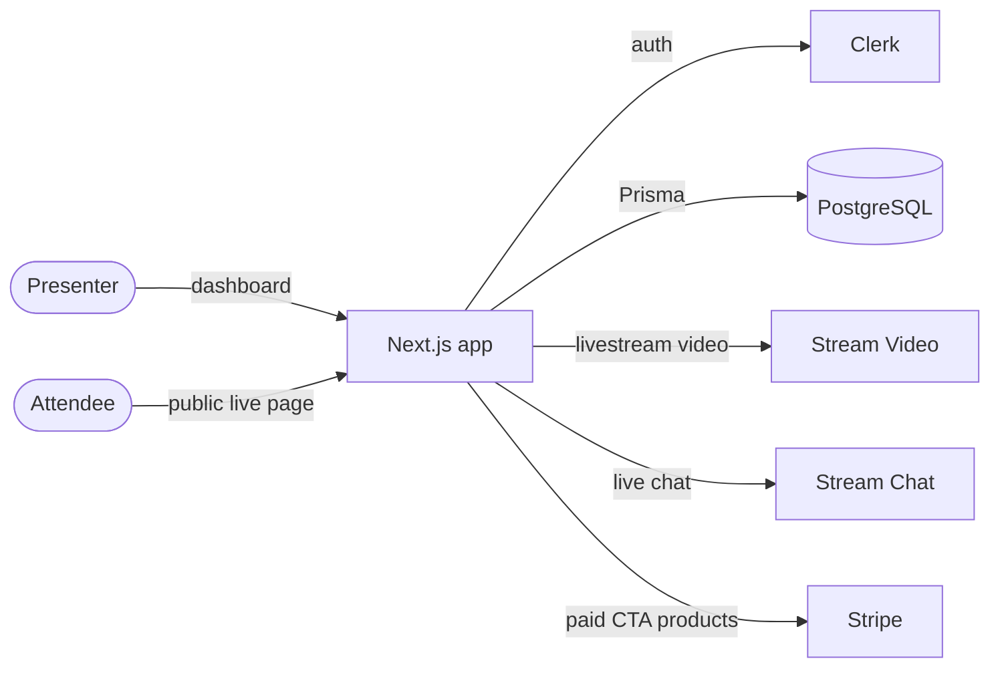
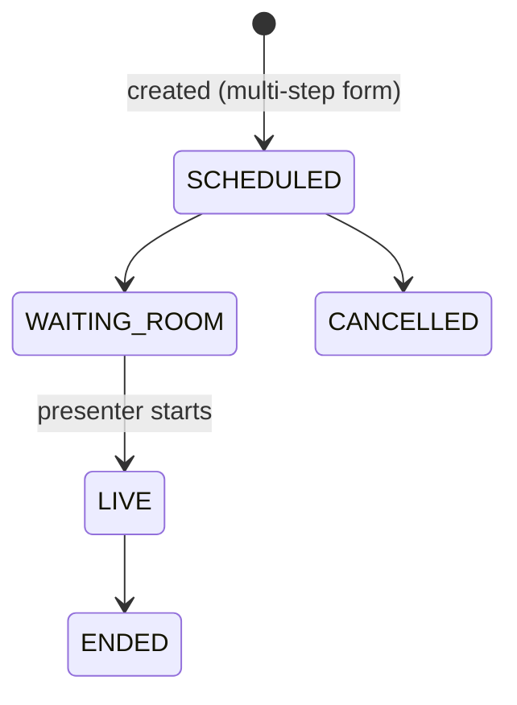

# Spotlight: High-Level Design

A webinar platform for marketers and business owners: create and schedule webinars, run a waiting room and live stream with chat, show a call-to-action (buy now or book a call), and track every attendee through a lead pipeline. For code-level detail see the [Low-Level Design](lld.md).

## 1. System context

## 2. Areas

| Area | Routes | Purpose |
|---|---|---|
| Auth | `/sign-in`, `/sign-up`, `/callback` | Clerk sign-in; first login creates the `User` row |
| Presenter dashboard | `/home`, `/webinars`, `/webinars/[id]`, `/webinars/[id]/pipeline`, `/lead`, `/settings` | Create webinars, see attendance, move leads, Stripe setting |
| Public live page | `/live-webinar/[id]` | Register, waiting room, live stream with chat and CTA |

## 3. Webinar lifecycle

## 4. Tech

| Layer | Choice |
|---|---|
| Framework | Next.js (App Router), React, TypeScript, server actions |
| Auth | Clerk |
| Data | Prisma + PostgreSQL |
| Live | Stream Video (livestream call type) and Stream Chat |
| State / UI | Zustand, react-hook-form + zod, shadcn/ui, Framer Motion, Recharts |

## 5. Current state

The webinar form already stores an AI agent choice (with a lead-qualification prompt in `lib/data.ts`) and the Stripe setting is a manual connect / disconnect flag; automated agent calls and real Stripe Connect onboarding are the next steps.
