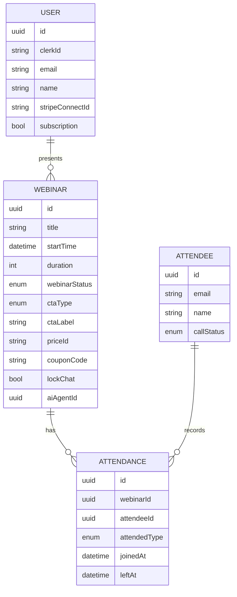
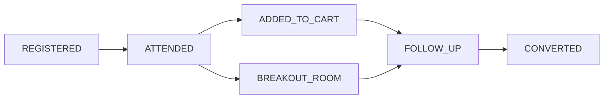
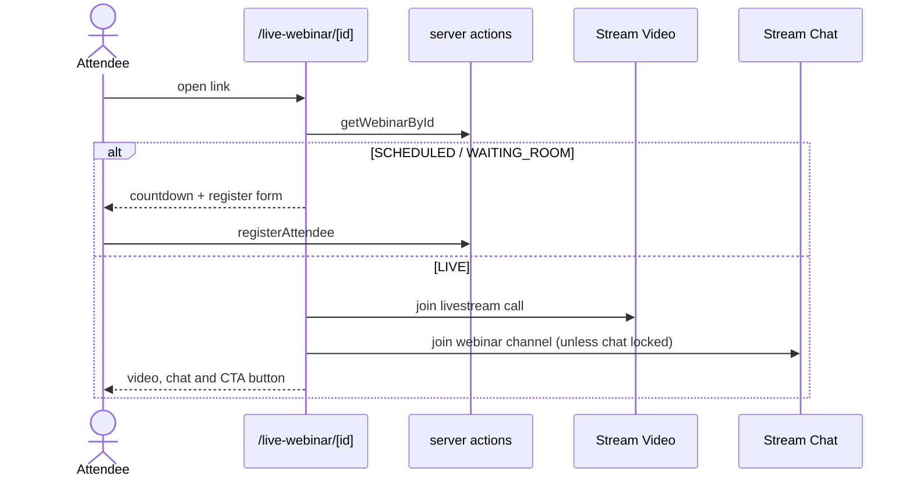

# Spotlight: Low-Level Design

For the big picture see the [High-Level Design](hld.md).

## 1. Data model (`prisma/schema.prisma`)

| Enum | Values |
|---|---|
| `WebinarStatusEnum` | SCHEDULED, WAITING_ROOM, LIVE, ENDED, CANCELLED |
| `CtaTypeEnum` | BUY_NOW, BOOK_A_CALL |
| `AttendedTypeEnum` | REGISTERED, ATTENDED, ADDED_TO_CART, FOLLOW_UP, BREAKOUT_ROOM, CONVERTED |
| `CallStatusEnum` | PENDING, InProgress, COMPLETED |

## 2. Server actions

| Action | Behavior |
|---|---|
| `onAuthenticateUser()` | Reads the Clerk user; returns the existing `User` or creates one |
| `createWebinar(form)` | Validates the multi-step form (basic info, CTA, additional info) and inserts a webinar |
| `getWebinarByPresenterId`, `getWebinarById` | Dashboard and live-page queries |
| `changeWebinarStatus(id, status)` | Moves the webinar through its lifecycle |
| `registerAttendee({ webinarId, email, name })` | Finds or creates the attendee, rejects a second registration for the same webinar, records `REGISTERED` attendance |
| `getWebinarAttendance(webinarId)` | `groupBy` attendance type → pipeline columns with counts and people |

## 3. Lead pipeline (typical progression)

The pipeline page shows one column per `AttendedTypeEnum` value; leads usually move like this:

## 4. Going live

## 5. Stripe toggle

`POST /api/toggle-stripe` (signed-in presenter) flips `User.stripeConnectId` between `null` and a placeholder value; it marks Stripe as connected for the UI rather than running Stripe Connect onboarding.
